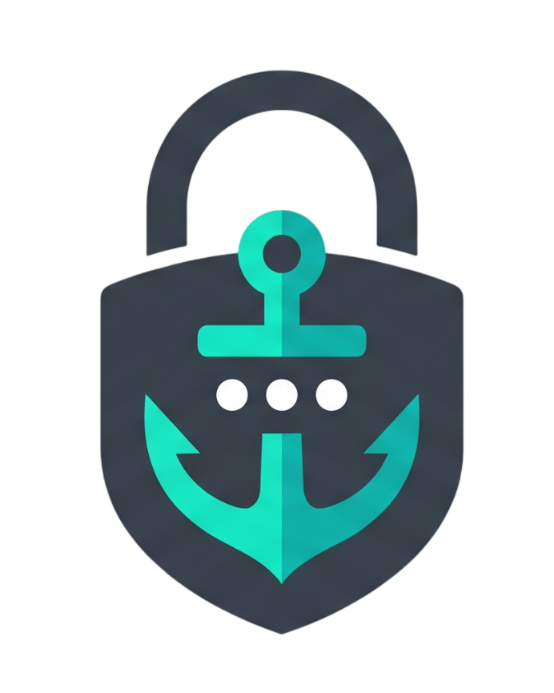

# 🛡️ HermitVault — Gestor de contraseñas offline (v2.0)



[Español](#español) · [English](#english)

---

## Español

### Índice

- [Descripción](#descripción)
- [Características](#características)
- [Tecnologías](#tecnologías)
- [Instalación](#instalación)
- [Compilación y distribución](#compilación-y-distribución)
- [Arquitectura de almacenamiento](#arquitectura-de-almacenamiento)
- [Auditoría de seguridad (mayo 2026)](#auditoría-de-seguridad-mayo-2026)
- [Licencia](#licencia)

### Descripción

**HermitVault** es un gestor de contraseñas **local y offline** pensado para quien prioriza la privacidad absoluta. Combina una interfaz web moderna con estética *glassmorphism* y un backend en **Python**, de modo que tus secretos nunca salen de tu equipo: sin nube, sin servidores externos y sin terceros.

### Características

**Seguridad de grado militar**

- **Arquitectura «zero knowledge»**: la contraseña maestra nunca se guarda. Solo se usa para derivar en memoria la clave de cifrado con **PBKDF2** y **AES-256**.
- **Análisis Pro con zxcvbn**: entropía profesional que detecta patrones, repeticiones y palabras de diccionario en tiempo real.
- **Protección anti fuerza bruta**: bloqueo progresivo con retardos exponenciales y persistencia entre reinicios mediante archivos de estado ofuscados y firmados.
- **Verificación humana (Slide to Verify)**: deslizador con objetivo aleatorio para frenar ataques automatizados.

**Sincronización e interoperabilidad**

- **Sincronización P2P** entre dispositivos de la misma red local, con fusión inteligente de datos y puerto configurable.
- **Importación desde navegadores**: Chrome, Edge, Firefox o archivos de texto, en `.csv` y `.txt`.
- **Exportación a Excel** para auditorías personales (con aviso de riesgo, ver auditoría).

**Experiencia de usuario**

- **Diseño glassmorphism** con desenfoques, degradados y micro-animaciones.
- **Modo claro/oscuro** con preferencia persistente.
- **Organización por carpetas**: Trabajo, Personal, Finanzas…
- **Notas seguras** cifradas dentro del mismo flujo de trabajo.

### Tecnologías

| Pieza | Tecnología |
|---|---|
| Backend | Python 3.13+ |
| Frontend | HTML5, Tailwind CSS, JavaScript (ES6+) |
| Puente GUI | [pywebview](https://pywebview.flowrl.com/) |
| Criptografía | [cryptography.io](https://cryptography.io/en/latest/) (AES-256 Fernet) |
| Análisis de seguridad | [zxcvbn](https://github.com/dropbox/zxcvbn) |
| Datos | Pandas y Openpyxl |

### Instalación

**Usuarios finales (instalador de Windows)**

1. Descarga `HermitVault_Setup.exe` (si está disponible en *Releases*).
2. Sigue el asistente.
3. La app se instala en `Program Files` y los datos se guardan en `%USERPROFILE%\HermitVault`.

**Desarrolladores**

```bash
git clone https://github.com/alberto2005-coder/HermitVault.git
cd HermitVault
pip install -r requirements.txt
python main.py
```

### Compilación y distribución

**1. Crear el ejecutable**

Ejecuta `build_exe.bat`. El script instala o actualiza las dependencias y usa **PyInstaller** para empaquetar el código, los recursos web y las librerías críticas (`zxcvbn`, `pandas`) en un único archivo dentro de `dist/`.

**2. Crear el instalador de Windows**

Usa `installer_script.iss` con **Inno Setup**: genera un instalador con iconos propios, accesos directos y metadatos del autor, y una desinstalación limpia que conserva tus datos cifrados.

### Arquitectura de almacenamiento

- **Directorio de datos**: `%USERPROFILE%\HermitVault` (Windows).
- **Archivos `.vault`**: contenedores cifrados con AES-256.
- **Archivo `.cache.dat`**: estado de seguridad y bloqueo anti fuerza bruta, firmado con HMAC-SHA256.

### Auditoría de seguridad (mayo 2026)

En mayo de 2026 el código se sometió a una auditoría para pasar de prototipo a estándar de producción. Se identificaron y mitigaron 12 vulnerabilidades:

1. **Autenticación en la sincronización P2P** — el servidor escuchaba en `0.0.0.0` y servía el `.vault` a cualquiera. Se añadió un **emparejamiento con PIN aleatorio de 6 dígitos** de un solo uso.
2. **Inyección HTML y XSS** — las tarjetas se pintaban con `innerHTML` sobre datos sin sanear. Se añadió `escapeHtml()` global y se eliminó la inyección directa.
3. **Cero exposición de credenciales en JS/DOM** — el puente devolvía la base descifrada. Ahora aplica **descifrado bajo demanda** y devuelve contraseñas enmascaradas (`••••••••`).
4. **Path traversal en creación/carga de bóvedas** — `vault_name` se concatenaba sin validar. Se añadió `sanitize_vault_name()`, que elimina `..`, `/` y `\`.
5. **Funcionamiento 100 % offline** — las CDN de Tailwind, Google Fonts, Material Symbols y librerías rompían el uso sin red. Todo se empaquetó en `/web`.
6. **KDF conforme a OWASP** — PBKDF2-HMAC-SHA256 pasó de 480.000 a **600.000 iteraciones**.
7. **Estado anti fuerza bruta firmado** — `.cache.dat` estaba solo en Base64. Ahora lleva **HMAC-SHA256** con clave derivada del UUID del hardware.
8. **Aviso en la exportación a Excel** — se añadió un **cuadro de confirmación** que advierte de que el archivo queda en texto plano.
9. **Escrituras atómicas** — `save_vault()` escribía directamente sobre la bóveda. Ahora escribe en `.tmpvault` y renombra de forma atómica.
10. **Rutas de importación y copia de seguridad** — `backup_vault()` e `import_vault()` usaban `os.getcwd()`. Ahora todo pasa por `get_data_dir()`.
11. **Robustez del protocolo de red** — `receive_vault()` acumulaba datos sin límite y el cliente usaba la sal local. Se limitó el payload a **50 MB**, se añadieron **timeouts de 15 s** y se re-deriva la clave con la **sal del servidor remoto**.
12. **Builds deterministas** — `requirements.txt` usaba `>=`. Ahora las versiones están fijadas (`pywebview==5.0.1`, `cryptography==42.0.5`, `pyinstaller==6.5.0`…).

### Licencia

Este proyecto está bajo la **Licencia MIT**. Consulta [LICENSE](LICENSE).

---

## English

### Table of contents

- [Overview](#overview)
- [Features](#features)
- [Tech stack](#tech-stack)
- [Installation](#installation)
- [Build and distribution](#build-and-distribution)
- [Storage architecture](#storage-architecture)
- [Security audit (May 2026)](#security-audit-may-2026)
- [License](#license)

### Overview

**HermitVault** is a **local, offline** password manager built for people who put privacy first. It pairs a modern *glassmorphism* web interface with a **Python** backend, so your secrets never leave your machine: no cloud, no external servers, no third parties.

### Features

**Military-grade security**

- **"Zero knowledge" architecture**: the master password is never stored. It only derives the encryption key in memory via **PBKDF2** and **AES-256**.
- **Pro analysis with zxcvbn**: professional entropy checks that catch patterns, repetition and dictionary words in real time.
- **Anti-brute-force protection**: progressive lockout with exponential delays, persisted across restarts through obfuscated, signed state files.
- **Human verification (Slide to Verify)**: a slider with a random target to hinder automated attacks.

**Sync and interoperability**

- **P2P sync** between devices on the same LAN, with smart data merging and a configurable port.
- **Browser import**: Chrome, Edge, Firefox or plain text files, `.csv` and `.txt`.
- **Excel export** for personal audits (with a risk warning, see the audit).

**User experience**

- **Glassmorphism design** with blurs, gradients and micro-animations.
- **Light/dark mode** with a persistent preference.
- **Folder organization**: Work, Personal, Finance…
- **Secure notes** encrypted inside the same workflow.

### Tech stack

| Piece | Technology |
|---|---|
| Backend | Python 3.13+ |
| Frontend | HTML5, Tailwind CSS, JavaScript (ES6+) |
| GUI bridge | [pywebview](https://pywebview.flowrl.com/) |
| Cryptography | [cryptography.io](https://cryptography.io/en/latest/) (AES-256 Fernet) |
| Security analysis | [zxcvbn](https://github.com/dropbox/zxcvbn) |
| Data | Pandas and Openpyxl |

### Installation

**End users (Windows installer)**

1. Download `HermitVault_Setup.exe` (if available under *Releases*).
2. Follow the wizard.
3. The app installs under `Program Files` and stores data in `%USERPROFILE%\HermitVault`.

**Developers**

```bash
git clone https://github.com/alberto2005-coder/HermitVault.git
cd HermitVault
pip install -r requirements.txt
python main.py
```

### Build and distribution

**1. Build the executable**

Run `build_exe.bat`. It installs or updates dependencies and uses **PyInstaller** to bundle the code, web assets and critical libraries (`zxcvbn`, `pandas`) into a single file under `dist/`.

**2. Build the Windows installer**

Use `installer_script.iss` with **Inno Setup**: it produces an installer with custom icons, shortcuts and author metadata, plus a clean uninstall that keeps your encrypted data safe.

### Storage architecture

- **Data directory**: `%USERPROFILE%\HermitVault` (Windows).
- **`.vault` files**: AES-256 encrypted containers.
- **`.cache.dat`**: security and anti-brute-force state, signed with HMAC-SHA256.

### Security audit (May 2026)

In May 2026 the codebase went through an audit to move from prototype to production grade. Twelve vulnerabilities were found and fixed:

1. **P2P sync authentication** — the server listened on `0.0.0.0` and served the `.vault` to anyone. Added a **random 6-digit PIN pairing flow** with single-use codes.
2. **HTML injection and XSS** — cards were rendered with `innerHTML` on unsanitized input. Added a global `escapeHtml()` and removed direct injection.
3. **No credential exposure in JS/DOM** — the bridge returned the decrypted database. Now it uses **decrypt-on-demand** and returns masked passwords (`••••••••`).
4. **Path traversal in vault create/load** — `vault_name` was concatenated unchecked. Added `sanitize_vault_name()`, stripping `..`, `/` and `\`.
5. **100 % offline operation** — Tailwind, Google Fonts, Material Symbols and libraries came from CDNs. Everything is now bundled in `/web`.
6. **OWASP-compliant KDF** — PBKDF2-HMAC-SHA256 went from 480,000 to **600,000 iterations**.
7. **Signed anti-brute-force state** — `.cache.dat` was Base64 only. It now carries an **HMAC-SHA256** keyed from the hardware UUID.
8. **Excel export warning** — added a **confirmation dialog** warning that the file is plaintext.
9. **Atomic writes** — `save_vault()` wrote straight over the vault. It now writes `.tmpvault` and renames atomically.
10. **Import and backup paths** — `backup_vault()` and `import_vault()` used `os.getcwd()`. All access now goes through `get_data_dir()`.
11. **Network protocol robustness** — `receive_vault()` buffered without limits and the client used the local salt. Payload capped at **50 MB**, **15 s socket timeouts** added, and the key is re-derived with the **remote server salt**.
12. **Deterministic builds** — `requirements.txt` used `>=`. Versions are now pinned (`pywebview==5.0.1`, `cryptography==42.0.5`, `pyinstaller==6.5.0`…).

### License

This project is under the **MIT License**. See [LICENSE](LICENSE).
